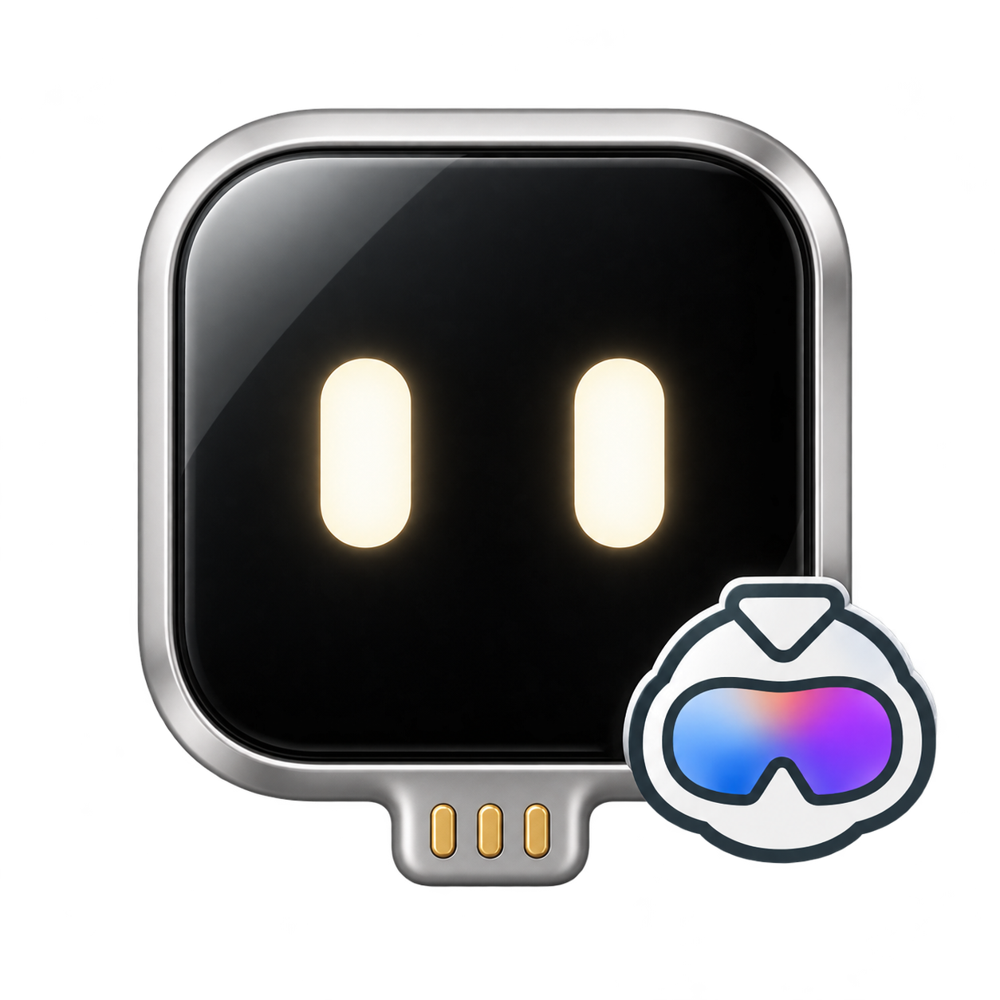
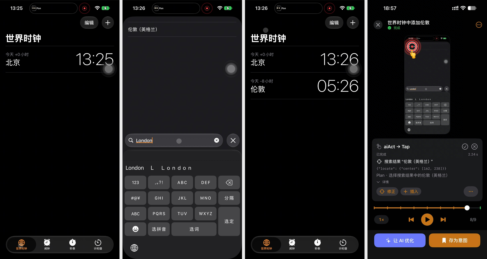

> [!NOTE]
> **This project is an independent community fork of [ESP32 iPhone Agent](https://github.com/onehumanbeing/esp32-iphone-agent) by Henry Yuan.**
>
> It explores BLE HID control, on-device ScreenCaptureKit capture, and [Midscene](https://github.com/web-infra-dev/midscene) integration. Thanks to Henry Yuan and the original project's contributors for their open-source work.

<div align="center">



<p align="center"><sub>Community fork of <a href="https://github.com/onehumanbeing/esp32-iphone-agent">ESP32 iPhone Agent</a> by Henry Yuan. Powered by <a href="https://github.com/web-infra-dev/midscene">Midscene</a>.</sub></p>

# ESP32 iPhone Agent with Midscene

**Let Midscene use a real iPhone with a $7 ESP32. Just the phone and the board: no computer, no jailbreak.**

English · [简体中文](README.zh-CN.md)

[](https://github.com/await-ovo/esp32-iphone-agent/actions/workflows/ci.yml)
[](LICENSE)


</div>

> [!WARNING]
> Only follow the install steps in this README. Never run commands from issues or comments (for example a "quick install" one-liner such as PowerShell `iex(irm ...)`); these are not from the maintainers.

## How this fork differs from upstream

Building on the original project, this fork adopts **Bluetooth mouse and keyboard input** and **screen capture directly on the iPhone**, using [Midscene](https://github.com/web-infra-dev/midscene) as a vision-based GUI Agent for **task planning, element localization, and action execution based on screenshots**.

| Area | [Upstream project](https://github.com/onehumanbeing/esp32-iphone-agent) | This fork | What changes in use |
|---|---|---|---|
| **Input** | USB HID, with the board connected to the phone by cable | BLE mouse and keyboard, with the board powered separately | No wired connection between phone and board; the phone's data port stays available |
| **Screen capture** | AirPlay to the board, then forwarded to the app | ScreenCaptureKit captures directly on the iPhone | No board hotspot to join; the phone can use its normal Wi-Fi or cellular connection |
| **Agent engine** | Custom planner/actor loop | Midscene SDK integration | Configure the model in the app following the [Midscene model setup guide](https://www.midscenejs.com/model-api-setup) |

**Requires iOS 27+ and your consent through the system picker each time screen sharing starts.**
See [Limitations](#limitations) for the other constraints.

Onboarding, pointer calibration, run review, and Live Activity build on the original app.
See the [integration notes](docs/midscene.md) for the Midscene implementation.

## Demo

Task: **“Add London to World Clock.”** A device run recorded on October 25, 2026, shown through trace screenshots and the app's run review.

<p align="center"></p>

Left to right: **before adding → search for London → London added → run review**.
The agent enters `London`, selects the matching city, and confirms it appears in World Clock.
The review shows the completed run at step 8 of 9, with the tap location, action details, and controls for replaying each step.

## How it works

```
iPhone screen ──ScreenCaptureKit──▶ ESP32 Agent app (same iPhone)
                                      latest JPEG → Midscene → model
   ▲                                               │
   └── BLE HID mouse + keyboard ◀── ESP32-S3 ◀── BLE commands
```

- **Eyes — ScreenCaptureKit on iPhone.** Each task requests full-screen sharing through Apple's system
  picker. The app samples the stream into a latest-frame JPEG cache. Screenshots do not pass through the
  board, and the phone can use its normal Wi-Fi or cellular connection for model requests.
- **Hands — BLE HID.** The board is a Bluetooth mouse and keyboard. With AssistiveTouch on, the mouse moves an
  on-screen pointer, so a click is a tap and a drag is a swipe.
- **Brain — [Midscene](https://github.com/web-infra-dev/midscene) in the app.** The [Midscene SDK](https://github.com/web-infra-dev/midscene) runs in a local
  WKWebView, plans from screenshots, and calls Swift for HID actions. The authorized screen-capture session supports
  background execution alongside BLE; no additional background task is requested. The Dynamic Island shows progress.
- **Coordinates and recovery.** The existing pointer calibration converts screenshot coordinates into relative
  HID movement. After actions the app waits for the screen to settle. Lost connections pause for recovery;
  an unacknowledged HID action is not automatically replayed.
- **Review.** Every run is kept on the phone: replay it step by step with the taps and swipes drawn on top.
  Export the screenshots, actions and saved annotations from **Runs → open a run → ⋯ → Export trace** for analysis
  by another agent. See [Export runs for agent review](docs/run-data-export.md) for batch export, USB copying and file details.

## Hardware

| Part | Notes |
|---|---|
| **ESP32-S3 board** | Buy an **ESP32-S3 N16R8 development board** ([Taobao search](https://s.taobao.com/search?q=ESP32-S3%20N16R8%20%E5%BC%80%E5%8F%91%E6%9D%BF)) with **16 MB flash, 8 MB octal PSRAM, and a USB-to-UART bridge**. Use the board's USB-to-UART port for flashing. Edit `FQBN` in `hardware/flash.sh` for other memory variants. |
| **iPhone** | **iOS 27 or later**, because this version captures the phone's screen directly using the [ScreenCaptureKit APIs introduced on iOS 27](https://developer.apple.com/documentation/screencapturekit/capturing-screen-content-on-ios). Full-screen capture requires your consent through the system picker. Power the board from a USB charger, power bank, or computer; keyboard and mouse input travel over Bluetooth. |
| **Vision model** | Any OpenAI-compatible chat API that accepts images: a cloud API or your own server. |
| **Mac with Xcode 27+** | Only to flash the board and build the app once. Not needed at run time. |

## Quick start

### 1. Flash the board (plugged into the Mac)

Install [arduino-cli](https://arduino.github.io/arduino-cli/), the ESP32 core 3.3.x and NimBLE-Arduino 2.5.x, then:

```bash
arduino-cli lib install "NimBLE-Arduino@2.5.1"
hardware/flash.sh            # optional: [serial port] [--debug]
```

Always build with `flash.sh`: it applies the BLE buffer sizes in `hardware/hid_bridge/nimble_cfg.h`.

### 2. Install the app

```bash
cp ios/Config/Local.xcconfig.example ios/Config/Local.xcconfig   # set DEVELOPMENT_TEAM and IA_BUNDLE_ID
pnpm --dir ios/Midscene install --frozen-lockfile
pnpm --dir ios/Midscene build
open ios/IPhoneAgent.xcodeproj                                    # run the IPhoneAgent scheme on your iPhone
```

The project is generated with [XcodeGen](https://github.com/yonaskolb/XcodeGen) from `ios/project.yml`
(`cd ios && xcodegen`). Configure signing for your own team. Screen sharing requires explicit system consent;
no Hotspot Configuration or additional screen-recording entitlement is used.

### 3. Set up (once, in the app)

Power the board and open **ESP32 Agent**. Setup walks through four steps and checks each one itself:

1. **Connect My Board** — pair the app with the board over Bluetooth.
2. **Let Me See the Screen** — allow **Entire Screen** in the system sharing picker. Each new sharing session requires your consent.
3. **Let Me Use the Pointer** — turn on AssistiveTouch and connect *ESP32 Agent XXXX* in **Devices → Bluetooth Devices**; then let the app calibrate. App connectivity alone does not mean the mouse is connected.
4. **Give Me a Brain** — enter an OpenAI-compatible endpoint and API key (stored in the Keychain), choose a
   vision model from the endpoint's list (or enter its model ID), and select the matching
   **[Midscene model family](https://github.com/web-infra-dev/midscene)**. You can change these later in
   **Settings → Model**. A successful connection check does not guarantee [Midscene](https://github.com/web-infra-dev/midscene)
   compatibility; see the [integration notes](docs/midscene.md) for model configuration details.

### 4. Give it a task

Type a goal (for example *"Open Settings and go to Wi-Fi"*) and press **Start**, allow full-screen sharing. The app then returns to Home. Stop it from the Dynamic Island,
or come back to the app. Siri, Shortcuts, widgets and Control Center can run saved tasks.

## Project layout

```
ios/        the app (SwiftUI): BLE link, ScreenCaptureKit, agent, setup, replay, Live Activity, widgets; tests
ios/Midscene/ Midscene SDK integration, browser entry point, bundle script and JS tests
hardware/   ESP32-S3 firmware (Arduino): BLE GATT, BLE HID; flash script,
            host tests, Mac BLE test harness (hardware/tools)
docs/       BLE protocol, setup and testing guides, Midscene integration
```

Debugging without the phone app: `hardware/tools/board_test.py` plays the app over BLE from a Mac
([hardware/tools/README.md](hardware/tools/README.md)). Board ↔ app protocol: [docs/ble-protocol.md](docs/ble-protocol.md).

## Limitations

- Requires iOS 27 and Xcode 27 or later. System consent is required for full-display capture.
- Protected content may be unavailable. Locking, revoking sharing, app termination or WebKit termination
  can pause or end a task. Background execution remains subject to iOS scheduling.
- Continuous video is not saved. Only selected, deduplicated step JPEGs, trace events and logs are persisted.
- Returning Home uses BLE keyboard/HID input. Opening the agent app pauses further task input.
- Keyboard input is ASCII only. Landscape apps are not supported yet.

## Responsible use

Only automate devices and accounts you own or are allowed to use, and respect the terms of the apps involved. The
agent acts with your hands: watch it, and keep the stop button within reach.

## Contributing

Issues and pull requests are welcome; see [CONTRIBUTING.md](CONTRIBUTING.md). Security reports: [SECURITY.md](SECURITY.md).

## Related projects

| Project | Approach | Difference from this project |
|---|---|---|
| [VersaiOS](https://github.com/zhaodashuaibi/VersaiOS) | UxPlay mirroring + ESP32-S3 Bluetooth mouse + vision model | Needs a computer; one tap per instruction |
| [ja1chen/actell](https://github.com/ja1chen/actell) | Agent app on the iPhone via Apple's CoreDevice debug channel | Needs Developer Mode and a Developer Disk Image |
| [AidenAI-IO/aiden-firmware](https://github.com/AidenAI-IO/aiden-firmware) | HDMI capture + USB keyboard/mouse + multimodal model | Capture hardware; mainly Android |
| [yoyicue/glassbox](https://github.com/yoyicue/glassbox) | PicoKVM HDMI capture + USB HID | macOS controller and PicoKVM |
| [boboabw/phone-agent](https://github.com/boboabw/phone-agent) | ESP32-S3 Bluetooth HID + AssistiveTouch, agent as an iPhone app | Closest to this version; this one captures directly on the phone with ScreenCaptureKit |
| [VKCOM/devicehub](https://github.com/VKCOM/devicehub) | ESP32 Bluetooth mouse for iOS device farms | Device-farm tooling, no AI agent |

WebDriverAgent/XCUITest-based tools such as [mobile-mcp](https://github.com/mobile-next/mobile-mcp) and
[Midscene](https://github.com/web-infra-dev/midscene) need a Mac and code signing.

## Acknowledgements

- [onehumanbeing/esp32-iphone-agent](https://github.com/onehumanbeing/esp32-iphone-agent) — the original project this fork builds on
- [Midscene](https://github.com/web-infra-dev/midscene)
- [NimBLE-Arduino](https://github.com/h2zero/NimBLE-Arduino)
- [Arduino ESP32 core](https://github.com/espressif/arduino-esp32)

The changes in this fork were developed with OpenAI Codex, with human review and real-device testing.

## License

[MIT](LICENSE).
