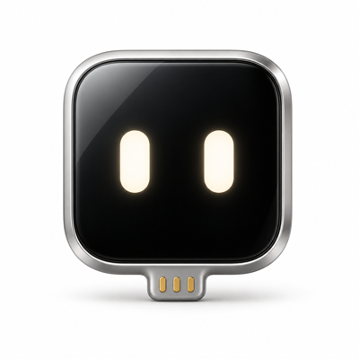

> [!NOTE]
> **本项目是 Henry Yuan 的 [ESP32 iPhone Agent](https://github.com/onehumanbeing/esp32-iphone-agent) 项目的独立社区 fork。**
>
> 在原项目基础上探索 BLE HID 控制、手机端 ScreenCaptureKit 屏幕采集，以及 [Midscene](https://github.com/web-infra-dev/midscene) 集成。感谢原作者 Henry Yuan 和原项目贡献者的开源工作。

<div align="center">



<p align="center"><sub>Community fork of <a href="https://github.com/onehumanbeing/esp32-iphone-agent">ESP32 iPhone Agent</a> by Henry Yuan. Powered by <a href="https://github.com/web-infra-dev/midscene">Midscene</a>.</sub></p>

# ESP32 iPhone Agent with Midscene

**让 Midscene 操作一部真实的 iPhone：只要手机和一块约 40 多元的 ESP32，不需要电脑，不用越狱。**

[English](README.md) · 简体中文

[](https://github.com/await-ovo/esp32-iphone-agent/actions/workflows/ci.yml)
[](LICENSE)


</div>

> [!WARNING]
> 请只按本 README 的步骤安装。不要运行 issue 或评论里的命令（例如 PowerShell 的 `iex(irm ...)` 之类“快速安装”一行命令），这些都不是维护者发的。

## 与[原项目](https://github.com/onehumanbeing/esp32-iphone-agent)的区别

在原项目基础上，我们改用**蓝牙键鼠控制**和 **iPhone 本机屏幕采集**，并使用 [Midscene](https://github.com/web-infra-dev/midscene) 作为视觉 GUI Agent，负责基于截图的**任务规划、元素定位与操作执行**。

| 对比项 | [原项目](https://github.com/onehumanbeing/esp32-iphone-agent) | 本项目 | 使用上的变化 |
|---|---|---|---|
| **控制方式** | USB HID，开发板通过数据线连接手机 | BLE 蓝牙键鼠，开发板独立供电 | 手机无需与开发板有线连接，数据接口可自由使用 |
| **屏幕获取** | AirPlay 投屏到开发板，再转发给 App | ScreenCaptureKit 在 iPhone 本机采集 | 无需连接开发板热点，手机可正常使用 Wi-Fi 或蜂窝网络 |
| **Agent 引擎** | 项目自定义的 planner/actor 循环 | 集成 Midscene SDK | 按 [Midscene 模型配置说明](https://www.midscenejs.com/zh/model-api-setup)，在 App 中填写对应的模型配置 |

**使用前提：iOS 27+，且每次开始屏幕共享都需要本人通过系统选择器授权。** 其他约束见[限制](#限制)。


## 实机演示

任务：**“世界时钟中添加伦敦。”** 以下展示为实机运行的 trace 截图与 App 历史记录截图：

<p align="center"></p>

从左到右：**添加前 → 搜索 London → 添加成功 → 运行复盘**。
Agent 输入 `London`，选择匹配的城市，并确认伦敦已出现在世界时钟中。
复盘页显示任务已完成，当前停在第 8/9 步，可以查看点击位置、动作详情，并逐步回放操作。

## 工作原理

```
iPhone 屏幕 ──ScreenCaptureKit──▶ 同一台手机上的 ESP32 Agent App
                                     最新 JPEG → Midscene → 模型
   ▲                                              │
   └── BLE HID 鼠标 + 键盘 ◀── ESP32-S3 ◀── 蓝牙命令
```

- **眼睛：手机直接采集。** 每次开始共享时，通过系统选择器允许共享「整个屏幕」。App 将屏幕流采样为最新 JPEG，画面不经过开发板，模型请求可使用正常的 Wi-Fi 或蜂窝网络。
- **手：BLE HID。** 板子是蓝牙鼠标和键盘。打开辅助触控（AssistiveTouch）后，鼠标控制屏幕上的指针，点击就是轻点，拖动就是滑动。
- **大脑——App 内的 [Midscene](https://github.com/web-infra-dev/midscene)。** [Midscene SDK](https://github.com/web-infra-dev/midscene) 在本地 WKWebView 中根据截图规划和定位，通过 Swift 调用 HID。通过已授权的屏幕采集和蓝牙后台模式执行，不额外申请后台任务；灵动岛显示进度。
- **坐标与恢复。** 沿用现有指针校准，将截图坐标换成 HID 相对移动。动作后等待画面稳定；断线时等待恢复，未收到确认的 HID 动作不自动重发。
- **复盘。** 每次运行都存在手机上，可以逐步回放，点按和滑动画在截图上。

## 硬件

| 部件 | 说明 |
|---|---|
| **ESP32-S3 板子** | 购买 **ESP32-S3 N16R8 开发板**（[淘宝搜索](https://s.taobao.com/search?q=ESP32-S3%20N16R8%20%E5%BC%80%E5%8F%91%E6%9D%BF)），选择 **16 MB Flash + 8 MB 八线 PSRAM、带 USB 转串口**的版本。刷写时连接板上的 USB 转串口接口；其他内存配置需修改 `hardware/flash.sh` 中的 `FQBN`。 |
| **iPhone** | **iOS 27 及以上**：本版本依赖 [iOS 27 新增的 ScreenCaptureKit 屏幕采集 API](https://developer.apple.com/documentation/screencapturekit/capturing-screen-content-on-ios)，直接在手机上获取屏幕画面；整屏采集需要通过系统选择器本人授权。板子通过 USB 充电器、充电宝或电脑供电，键鼠操作通过蓝牙发送。 |
| **视觉模型** | 任何支持图片输入、兼容 OpenAI 接口的模型：云端 API 或自己部署。 |
| **装了 Xcode 27+ 的 Mac** | 只在刷板子、编译 App 时用一次，运行时不需要。 |

## 快速开始

### 1. 刷板子（插在 Mac 上）

安装 [arduino-cli](https://arduino.github.io/arduino-cli/)、ESP32 core 3.3.x 和 NimBLE-Arduino 2.5.x，然后：

```bash
arduino-cli lib install "NimBLE-Arduino@2.5.1"
hardware/flash.sh            # 可选参数：[串口] [--debug]
```

一定要用 `flash.sh` 编译：它会带上 `hardware/hid_bridge/nimble_cfg.h` 里的蓝牙缓冲区配置。

### 2. 安装 App

```bash
cp ios/Config/Local.xcconfig.example ios/Config/Local.xcconfig   # 填 DEVELOPMENT_TEAM 和 IA_BUNDLE_ID
pnpm --dir ios/Midscene install --frozen-lockfile
pnpm --dir ios/Midscene build
open ios/IPhoneAgent.xcodeproj                                    # 在 iPhone 上运行 IPhoneAgent scheme
```

工程由 [XcodeGen](https://github.com/yonaskolb/XcodeGen) 从 `ios/project.yml` 生成（`cd ios && xcodegen`）。按自己的团队配置签名。屏幕共享通过系统弹窗明确授权，不使用 Hotspot Configuration 或额外的屏幕录制 entitlement。

### 3. 首次设置（在 App 里）

给板子供电，打开 **ESP32 Agent**。引导共四步，每一步 App 自己检测：

1. **Connect My Board**：App 通过蓝牙连接板子。
2. **Let Me See the Screen**：在系统选择器中允许共享「整个屏幕」。每个新共享会话都需要本人授权。
3. **Let Me Use the Pointer**：打开辅助触控，在「设备 → 蓝牙设备」连接 *ESP32 Agent XXXX*，再由 App 校准。App 已连接不等于系统鼠标已连接。
4. **Give Me a Brain**：填写 OpenAI 兼容的接口地址和 API 密钥（存在钥匙串里），从接口的模型列表选择支持图片输入的模型（或手动填写模型 ID），并选择对应的 **[Midscene model family](https://github.com/web-infra-dev/midscene)**。之后可在「设置 → 模型」修改。连接测试通过不代表模型已兼容 [Midscene](https://github.com/web-infra-dev/midscene)，模型配置细节见[接入说明](docs/midscene.md)。

### 4. 给它一个任务

输入目标（比如 *"打开设置，进入无线局域网"*），点 **Start**，允许整屏共享，随后 App 会回到桌面。可以从灵动岛停止，或回到 App 停止。Siri、快捷指令、小组件和控制中心可以运行保存的任务。

## 目录结构

```
ios/        App（SwiftUI）：蓝牙连接、ScreenCaptureKit、Agent、引导、回放、实时活动、小组件；单元测试
ios/Midscene/ Midscene SDK 集成、浏览器入口、打包脚本与 JS 测试
hardware/   ESP32-S3 固件（Arduino）：蓝牙 GATT、BLE HID；刷写脚本、
            主机测试、Mac 蓝牙调试工具（hardware/tools）
docs/       蓝牙协议、配置与测试指南、Midscene 接入说明
```

不用手机 App 调试：`hardware/tools/board_test.py` 在 Mac 上通过蓝牙扮演 App（[hardware/tools/README.md](hardware/tools/README.md)）。板子与 App 的协议：[docs/ble-protocol.md](docs/ble-protocol.md)。

## 限制

- 要求 iOS 27 和 Xcode 27 及以上；整屏共享需要通过系统选择器明确授权。
- 受保护的内容可能不可见。锁屏、撤销共享、系统终止 App 或 WebKit 退出会暂停或结束任务；后台执行受 iOS 调度限制。
- 不保存连续视频，只持久化选中的去重步骤 JPEG、trace 和日志。
- 通过 BLE 键盘/HID 返回桌面；用户打开 Agent App 时，后续任务操作暂停。
- 键盘输入只支持 ASCII。暂不支持横屏 App。

## 负责任地使用

只自动化你拥有或有权使用的设备和账号，遵守相关 App 的条款。Agent 是在用你的手操作：看着它，随时准备停止。

## 参与贡献

欢迎提 Issue 和 PR，见 [CONTRIBUTING.md](CONTRIBUTING.md)。安全问题：[SECURITY.md](SECURITY.md)。

## 相关项目

| 项目 | 方式 | 与本项目的区别 |
|---|---|---|
| [VersaiOS](https://github.com/zhaodashuaibi/VersaiOS) | UxPlay 镜像 + ESP32-S3 蓝牙鼠标 + 视觉模型 | 需要电脑；一条指令一次点击 |
| [ja1chen/actell](https://github.com/ja1chen/actell) | iPhone 上的 Agent App，走 Apple CoreDevice 调试通道 | 需要开发者模式和开发者磁盘映像 |
| [AidenAI-IO/aiden-firmware](https://github.com/AidenAI-IO/aiden-firmware) | HDMI 采集 + USB 键鼠 + 多模态模型 | 需要采集硬件；主要面向 Android |
| [yoyicue/glassbox](https://github.com/yoyicue/glassbox) | PicoKVM HDMI 采集 + USB HID | 需要 macOS 控制端和 PicoKVM |
| [boboabw/phone-agent](https://github.com/boboabw/phone-agent) | ESP32-S3 蓝牙 HID + 辅助触控，Agent 是 iPhone App | 最接近新版；本项目通过 ScreenCaptureKit 在手机内直接采集画面 |
| [VKCOM/devicehub](https://github.com/VKCOM/devicehub) | ESP32 蓝牙鼠标，用于 iOS 设备农场 | 设备农场工具，没有 AI Agent |

基于 WebDriverAgent/XCUITest 的工具，如 [mobile-mcp](https://github.com/mobile-next/mobile-mcp) 和 [Midscene](https://github.com/web-infra-dev/midscene)，需要 Mac 和代码签名。

## 致谢

- [onehumanbeing/esp32-iphone-agent](https://github.com/onehumanbeing/esp32-iphone-agent) —— 本 fork 所基于的原项目
- [Midscene](https://github.com/web-infra-dev/midscene)
- [NimBLE-Arduino](https://github.com/h2zero/NimBLE-Arduino)
- [Arduino ESP32 core](https://github.com/espressif/arduino-esp32)

本 fork 的新增功能与改造使用 OpenAI Codex 开发，并结合人工审阅与实机测试进行验证。

## 许可证

[MIT](LICENSE)。
